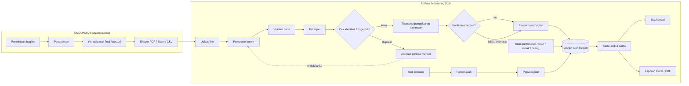
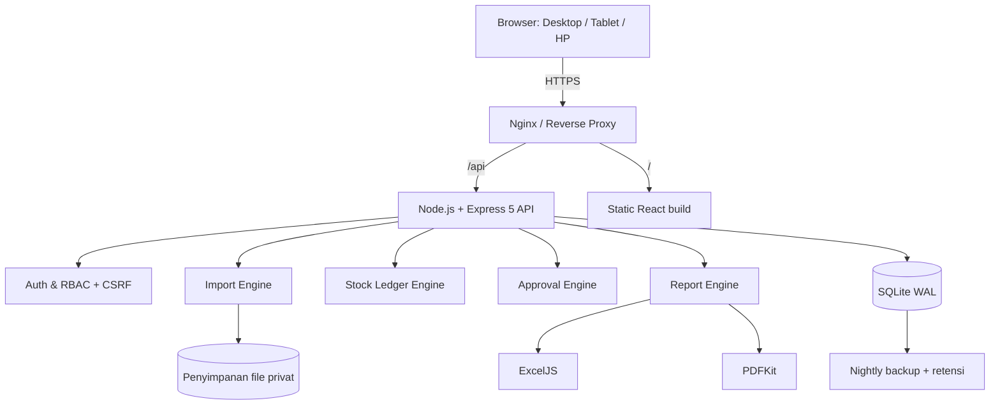
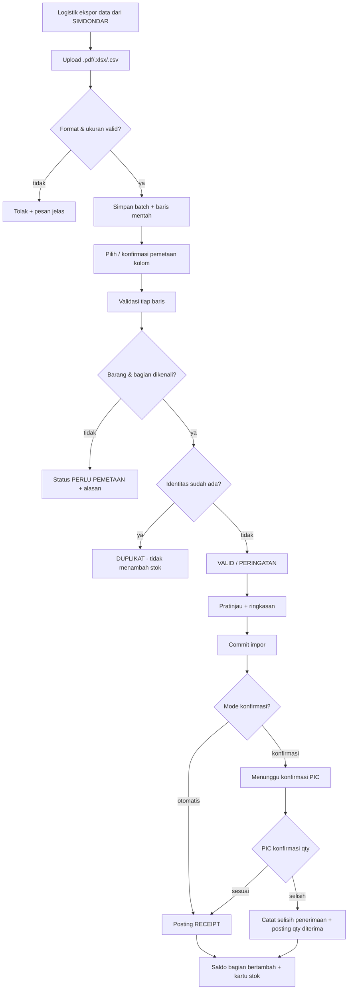
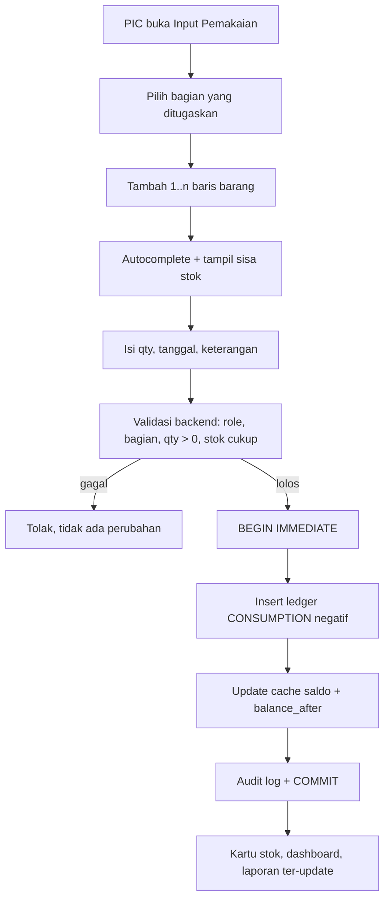
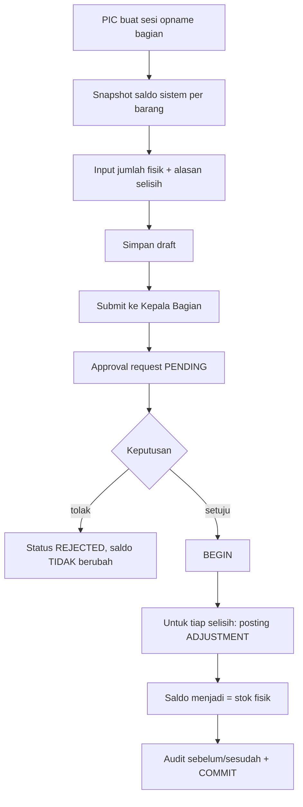
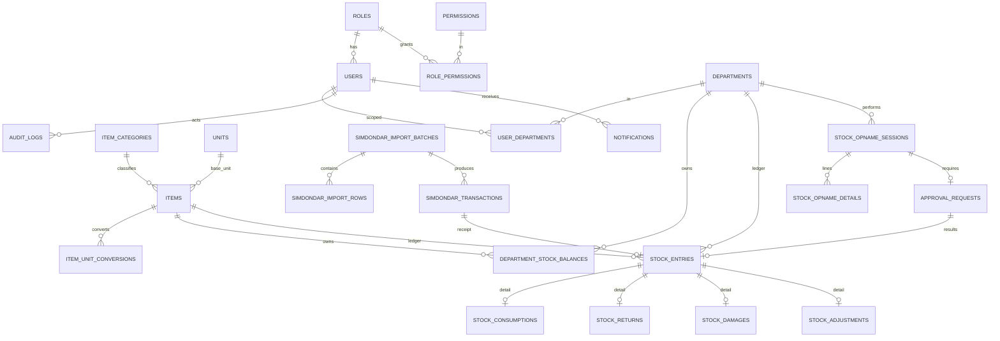

# ANALISIS SISTEM — Monitoring Stok dan Pemakaian Per Bagian

> Dokumen ini adalah **Fase 1 (Analisis)** dari pengembangan aplikasi pendamping SIMDONDAR.
> Sumber acuan: `PRD_Manajemen_Stok_Per_Bagian_v1.1_Simdondar.docx` (4 November 2026) dan instruksi pengguna.
> Versi implementasi MVP: 1.0.0

---

## 1. Ringkasan Pemahaman Kebutuhan

### 1.1 Posisi aplikasi

| Aspek | SIMDONDAR | Aplikasi ini |
|---|---|---|
| Peran | Sistem utama permintaan & pengeluaran barang dari Logistik | Sub-ledger stok **setelah** barang keluar Logistik |
| Sumber data masuk | Input transaksi Logistik | Impor ekspor SIMDONDAR (PDF/Excel/CSV), lalu opsional konfirmasi terima |
| Tanggung jawab | Menyatakan apa yang diminta & dikeluarkan | Menyatakan apa yang diterima, dipakai, diretur, rusak, hilang, dan sisa stok per bagian |
| Saldo gudang pusat | Sumber resmi | **Tidak dihitung ulang.** Hanya ringkasan pengeluaran yang diimpor |
| Koreksi | Prosedur SIMDONDAR | Transaksi pembalik/penyesuaian dengan approval & audit trail |

Aplikasi **tidak** membuat formulir permintaan baru, **tidak** mengetik ulang pengeluaran, dan **tidak** mengurangi saldo gudang pusat.

### 1.2 Masalah yang diselesaikan

1. Logistik tidak mengetahui sisa barang di tiap bagian setelah barang diserahkan.
2. Pemakaian, kerusakan, kehilangan, dan retur tidak tercatat sehingga tidak dapat diaudit.
3. Tidak ada pembanding antara stok sistem dan stok fisik.
4. Tidak ada dasar data pemakaian untuk perencanaan Pengadaan.
5. Tidak ada kontrol bahwa pemakaian sesuai jumlah yang diterima.

### 1.3 Prinsip yang dipegang

- **Akurasi dulu**: saldo hanya berubah melalui ledger transaksi; angka saldo tidak pernah ditimpa.
- **Append-only**: transaksi posted tidak diedit/dihapus; koreksi = reversal + transaksi pengganti.
- **Idempotent import**: file yang sama tidak menambah penerimaan dua kali.
- **Least privilege**: otorisasi role + cakupan bagian diperiksa di backend pada setiap endpoint.
- **Tidak mengarang data**: kolom yang tidak ada di file sumber ditampilkan “Tidak tersedia”; pemetaan kolom dilakukan pengguna, bukan diasumsikan.
- **Satu sumber kebenaran per angka**: Qty diminta ≠ Qty keluar ≠ Qty diterima ≠ Pemakaian.

### 1.4 Asumsi sementara yang ditandai

| # | Asumsi | Dampak bila salah |
|---|---|---|
| A1 | Ekspor SIMDONDAR berbentuk tabel dengan baris judul (header) dan minimal memuat tanggal, barang, jumlah keluar, satuan, bagian penerima | Pemetaan kolom di wizard impor harus disesuaikan; tidak ada perubahan kode inti |
| A2 | Bila nomor dokumen + nomor baris tersedia, keduanya unik di SIMDONDAR | Idempotensi memakai fingerprint + pemeriksaan manual |
| A3 | Satu barang mempunyai satu satuan dasar; satuan lain memakai konversi | Bila multi-satuan paralel, master konversi perlu dilengkapi |
| A4 | “Logistik” dan “Logistik dan Pengadaan” adalah dua unit berbeda | Master bagian mudah digabung/dinonaktifkan |
| A5 | Konfirmasi penerimaan dapat diaktifkan/dimatikan (default: aktif) | Ubah di Pengaturan |
| A6 | MVP mengutamakan kuantitas, bukan nilai rupiah | Valuasi dapat ditambah di tahap 2 |
| A7 | Waktu server = zona waktu organisasi (Asia/Jakarta) | Timestamp disimpan UTC, ditampilkan lokal |
| A8 | Data historis SIMDONDAR dapat diekspor untuk saldo awal | Saldo awal dapat diinput lewat impor atau penyesuaian awal |

**Data yang masih perlu disiapkan (tidak menghambat MVP):**
1. **Satu contoh file ekspor SIMDONDAR asli (.xlsx/.csv)** beserta menu/filter ekspornya.
2. Daftar kode barang resmi + satuan + kategori + stok minimum.
3. Kode bagian pada SIMDONDAR (jika berbeda dari nama bagian).
4. Kebijakan: apakah bagian wajib konfirmasi terima; ambang nominal persetujuan koreksi; periode opname.
5. Struktur organisasi final (apakah ada penggabungan unit).
6. Apakah laporan perlu kop surat/tanda tangan (PDF).

Semua kolom penting dibuat **dapat dipetakan** di UI, sehingga file asli tidak perlu diubah saat formatnya baru tersedia.

---

## 2. Alur Data SIMDONDAR → Aplikasi

**Aturan kunci:**
- Transaksi sumber disimpan utuh (raw row + identitas). Tidak ada update qty sumber dari aplikasi ini.
- Hanya **qty keluar** yang menambah stok bagian (atau qty diterima bila konfirmasi aktif).
- Qty diminta hanya informasi, tidak pernah menjadi dasar saldo.
- Bila barang yang sama diimpor ulang, identitas unik mencegah double receipt.

---

## 3. Arsitektur Aplikasi

**Keputusan teknologi (dan alasannya):**

| Lapisan | Teknologi | Alasan |
|---|---|---|
| Frontend | React 19 + TypeScript + Vite + Tailwind CSS 4 | Ekosistem matang, build cepat, komponen reusable, responsif |
| Backend | Node.js 24+ + Express 5 + TypeScript (tsx) | Satu bahasa, async I/O, middleware keamanan lengkap, tim mudah merawat |
| Database | SQLite (WAL) via `node:sqlite` bawaan | Zero-install, transaksi ACID, cukup untuk puluhan pengguna intranet; mudah dibackup satu file; tanpa native dependency |
| Ledger | Tabel `stock_entries` append-only + cache saldo | Saldo dapat direkonstruksi; konsistensi dijaga transaksi DB |
| Validasi | Zod (server) + validasi form (client) | Satu skema, pesan jelas, mencegah input tidak sah |
| Excel | ExcelJS (baca/tulis .xlsx) + parser CSV | Tidak butuh Excel terpasang; mendukung styling laporan |
| PDF | pdfjs-dist (baca ekspor SIMDONDAR) + PDFKit (laporan) | PDF SIMDONDAR dibaca berdasarkan posisi teks; kolom harga/total diabaikan. Laporan PDF dibuat server-side tanpa browser headless |
| Auth | Cookie session httpOnly + hash scrypt + CSRF double-submit | Tidak menyimpan token di localStorage; aman dari XSS token theft |
| Test | Vitest + Supertest | Uji unit ledger + uji integrasi API |

**Mengapa SQLite:** beban operasional normal (≤ 50 pengguna, ribuan transaksi/bulan), deployment intranet sederhana, backup = salin file (dengan WAL checkpoint), tidak perlu server DB terpisah. Bila kelak perlu multi-server, skema relasional dapat dipindah ke PostgreSQL dengan perubahan driver.

---

## 4. Flowchart Proses

### 4.1 Barang masuk (penerimaan dari SIMDONDAR)

### 4.2 Pemakaian harian

### 4.3 Stok opname & persetujuan selisih

**Catatan penting:** sebelum approval, saldo sistem tetap 5 pack walau fisik 4 pack. Selisih −1 hanya informasi. Setelah disetujui, penyesuaian −1 dibukukan.

---

## 5. Rancangan Database (ERD)

### 5.1 Keputusan desain

1. **Satu ledger** (`stock_entries`) untuk semua pergerakan. Tabel detail per jenis hanya menyimpan atribut khusus. Ini mencegah saldo ganda dan memudahkan kartu stok.
2. **`qty_delta` bertanda** (+ masuk, − keluar) dengan `balance_after` per (bagian, barang).
3. **Cache saldo** (`department_stock_balances`) di-update dalam transaksi DB yang sama; dapat direkonsiliasi dari ledger.
4. **`source_identity` unik** pada transaksi SIMDONDAR; raw row disimpan untuk audit.
5. **Approval** menyimpan payload JSON + resulting entry; tidak ada perubahan saldo saat status PENDING.
6. **Opname detail** menyimpan snapshot `system_qty`; perubahan stok setelah snapshot tidak mengubah angka pembanding sesi.
7. **Audit log** menyimpan before/after JSON dan alasan.
8. **Foreign key + CHECK constraint** mencegah qty nol, tanggal tidak valid, dan referensi yatim; indeks disiapkan untuk query kartu stok/dashboard.

### 5.2 Tabel akhir (implementasi)

`roles`, `permissions`, `role_permissions`, `users`, `user_departments`, `departments`, `item_categories`, `units`, `items`, `item_unit_conversions`, `sessions`, `simdondar_import_batches`, `simdondar_import_rows`, `simdondar_transactions`, `department_stock_balances`, `stock_entries`, `stock_consumptions`, `stock_returns`, `stock_damages`, `stock_adjustments`, `stock_opname_sessions`, `stock_opname_details`, `approval_requests`, `audit_logs`, `notifications`, `settings`, `document_sequences`, `attachments`.

---

## 6. Role & Permission

| Permission | Super Admin | Wakil Kepala | Kabid Logistik | Staf Logistik | Kepala Bagian | PIC | Auditor |
|---|---|---|---|---|---|---|---|
| dashboard.view (scoped) | ✓ | ✓ | ✓ | ✓ | ✓ | ✓ | ✓ |
| dashboard.view_all | ✓ | ✓ | ✓ | ✓ | – | – | ✓ |
| items.view | ✓ | ✓ | ✓ | ✓ | ✓ | ✓ | ✓ |
| items.manage | ✓ | – | ✓ | – | – | – | – |
| departments.view | ✓ | ✓ | ✓ | ✓ | ✓ | ✓ | ✓ |
| departments.manage | ✓ | – | – | – | – | – | – |
| imports.view | ✓ | ✓ | ✓ | ✓ | – | – | ✓ |
| imports.manage | ✓ | – | ✓ | ✓ | – | – | – |
| stocks.view scoped | ✓ | ✓ | ✓ | ✓ | ✓ | ✓ | ✓ |
| stocks.view_all | ✓ | ✓ | ✓ | ✓ | – | – | ✓ |
| receipts.confirm | ✓ | – | ✓ | ✓ | ✓ | ✓ | – |
| consumptions.create | ✓ | – | – | – | – | ✓ | – |
| returns.create | ✓ | – | – | – | – | ✓ | – |
| damages.create (request) | ✓ | – | – | – | – | ✓ | – |
| adjustments.request | ✓ | – | ✓ | – | ✓ | ✓ | – |
| opnames.create | ✓ | – | – | – | – | ✓ | – |
| opnames.view_all | ✓ | ✓ | ✓ | ✓ | – | – | ✓ |
| approvals.view | ✓ | ✓ | ✓ | ✓ | ✓ | ✓ | ✓ |
| approvals.decide | – | – | ✓ | – | ✓ | – | – |
| reports.view / export | ✓ | ✓ | ✓ | ✓ | ✓ | ✓ (bagian) | ✓ |
| users.manage | ✓ | – | – | – | – | – | – |
| audit.view | ✓ | – | – | – | – | – | ✓ |
| settings.manage | ✓ | – | – | – | – | – | – |

- **Cakupan bagian**: Super Admin, Wakil Kepala, Kabid/Staf Logistik, Auditor = lintas bagian. Kepala Bagian/PIC hanya `user_departments` miliknya.
- Pemisahan tugas: pengaju tidak boleh menyetujui permintaannya sendiri.
- Otorisasi dicek **di setiap service/endpoint**, bukan hanya menu.

---

## 7. Rancangan Dashboard

| Role | Kartu metrik | Grafik | Daftar tindakan |
|---|---|---|---|
| Wakil Kepala | item aktif, bagian, total sisa stok, pemakaian periode, selisih opname | tren pemakaian, stok per bagian | selisih menunggu, bagian belum input, opname terbaru |
| Logistik | pengeluaran SIMDONDAR, diterima, pemakaian, sisa, stok kritis, impor terakhir | distribusi per bagian, tren pengeluaran vs pemakaian, top barang | impor gagal/duplikat, penerimaan menunggu, bagian terlambat |
| Kepala Bagian / PIC | saldo bagian, penerimaan bulan ini, pemakaian bulan ini, item kritis | tren pemakaian bagian, komposisi kategori | penerimaan menunggu konfirmasi, approval, status opname |
| Auditor | metrik baca saja + audit terbaru | tren | transaksi terbaru |

Semua angka berasal dari query database; tautan “Lihat detail” membuka daftar transaksi terfilter (drill-down). Filter global: periode, bagian, kategori, barang.

---

## 8. Rancangan Modul & Prioritas

| Modul | Isi MVP | Status |
|---|---|---|
| Autentikasi & RBAC | login, logout, ganti password, sesi, CSRF, rate limit | Dibangun |
| Master | bagian (23), kategori, satuan, konversi, barang, stok minimum, kode SIMDONDAR | Dibangun |
| Impor SIMDONDAR | upload, peta kolom, validasi, pratinjau, anti-duplikat, riwayat, unduh error, auto-create master barang/bagian | Dibangun |
| Penerimaan | konfirmasi PIC, selisih penerimaan | Dibangun |
| Pemakaian | multi-baris, autocomplete, validasi stok, riwayat, koreksi ber-approval | Dibangun |
| Pergerakan lain | retur, rusak, hilang, penyesuaian | Dibangun |
| Kartu stok | append-only, saldo berjalan, filter | Dibangun |
| Stok opname | sesi, snapshot, fisik, selisih, submit, approval, histori | Dibangun |
| Dashboard | role-aware, filter, grafik, drill-down | Dibangun |
| Laporan | 12 jenis, Excel & PDF | Dibangun |
| Approval | antrean, setuju/tolak, alasan, audit | Dibangun |
| Audit & notifikasi | log lengkap, notifikasi dalam aplikasi | Dibangun |
| Pengaturan | mode penerimaan, ambang koreksi, identitas aplikasi | Dibangun |
| Backup/restore | skrip + panduan | Dibangun |

**Di luar MVP (tahap 2):** API/webhook SIMDONDAR, barcode/QR, notifikasi WhatsApp/email, valuasi persediaan, mobile native, approval berjenjang kompleks.

---

## 9. Urutan Pengerjaan Terukur

| Fase | Deliverable | Kriteria selesai |
|---|---|---|
| 1. Analisis | dokumen ini + ERD + asumsi | disetujui pemilik proses |
| 2. Fondasi | project, migrasi, seed 23 bagian, login, RBAC, master | login semua role; akses lintas bagian ditolak 403 |
| 3. Integrasi | wizard impor, anti-duplikat, penerimaan | file sama 2× tidak menambah stok |
| 4. Operasional | pemakaian, kartu stok, retur, rusak/hilang, penyesuaian, opname | skenario 10−2−3=5 dan opname −1 terbukti |
| 5. Dashboard & laporan | 3 dashboard, 12 laporan, ekspor | angka sama dengan query sumber; PDF/XLSX terbuka |
| 6. QA & deploy | tes otomatis, uji keamanan, dokumentasi, backup | seluruh tes lulus; restore diuji |

---

## 10. Risiko & Mitigasi

| Risiko | Mitigasi |
|---|---|
| Format ekspor SIMDONDAR berubah | pemetaan kolom disimpan sebagai profil; validasi menolak file tidak dikenali, tidak menebak |
| Kode barang tidak konsisten | kolom kode SIMDONDAR di master + antrean “Perlu Pemetaan”; opsi auto-create saat impor membuat barang/bagian baru bila belum ada di master |
| Two users post simultaneously | `BEGIN IMMEDIATE` + validasi saldo di dalam transaksi |
| Stok negatif | ditolak default; tidak ada “edit saldo” langsung |
| Kebocoran antar bagian | scope server-side + tes 403 |
| Kehilangan data | WAL + backup harian + panduan restore + audit |
| Import ganda | unique `source_identity` + fingerprint + flag pemeriksaan manual |
| Selisih opname dianggap otomatis | approval wajib; saldo tidak berubah saat PENDING |

---

## 11. Pertanyaan yang Masih Perlu Dikonfirmasi (tidak menghambat MVP)

1. Contoh file ekspor SIMDONDAR yang asli (nama kolom, apakah ada nomor dokumen/baris, format tanggal, kode bagian).
2. Apakah bagian wajib konfirmasi terima atau otomatis diterima?
3. Siapa berwenang menyetujui koreksi: Kepala Bagian saja, Kabid, atau berjenjang?
4. Apakah ada nilai harga untuk laporan valuasi?
5. Format kop/tanda tangan PDF dan periode opname resmi.
6. Apakah “Logistik” dan “Logistik dan Pengadaan” definitif dua unit?

Jawaban dapat diberikan setelah aplikasi berjalan; semua poin di atas sudah memiliki konfigurasi/penyesuaian yang aman.

---

## 12. Status Implementasi dan Verifikasi (4 November 2026)

| Area | Bukti verifikasi |
|---|---|
| Typecheck | `npm run typecheck` lulus untuk server dan client |
| Build produksi | `npm run build` lulus; frontend tersaji oleh server dari `client/dist` |
| Tes integrasi API | `npm test` — 16 tes lulus di 2 berkas (Vitest + Supertest, database in-memory), termasuk 2 tes impor PDF dengan fixture `servise-donor.pdf` |
| Alur stok | Impor 10 → konfirmasi → pemakaian 2 + 3 → saldo 5; pemakaian melebihi stok ditolak 422 |
| Opname | Fisik 4 dari sistem 5 → diajukan; saldo tetap 5; persetujuan mengubah saldo menjadi 4 |
| Approval | Pengaju tidak dapat menyetujui pengajuan sendiri (403); approver lain berhasil |
| Anti-duplikat | File yang sama divalidasi sebagai duplikat dan commit tidak menambah transaksi |
| RBAC | PIC ditolak 403 untuk impor dan akses bagian lain; akses bagian sendiri berhasil |
| CSRF | Mutasi tanpa header `X-CSRF-Token` ditolak 403 |
| Impor PDF | Ekstraksi posisi teks dari ekspor SIMDONDAR menghasilkan baris yang benar; kolom harga dan total diabaikan; PDF hasil pindai ditolak |
| Laporan | 12 jenis laporan merespons; ekspor XLSX dan PDF valid |
| Audit | Aksi LOGIN, COMMIT_IMPORT, dan APPROVE_REQUEST tercatat |
| UI | Login, dashboard, stok, kartu stok, pemakaian, penerimaan, opname, persetujuan, impor, master, laporan, audit, pengaturan dimuat tanpa error runtime; wizard impor dan simpan pemakaian diuji lewat browser |

Database development kemudian direset ke kondisi awal (admin + seed 23 bagian) agar serah terima bersih. Contoh berkas impor tersedia di `docs/contoh-import-simdondar.csv`, dan contoh ekspor SIMDONDAR asli tersedia sebagai fixture PDF di `server/tests/fixtures/servise-donor.pdf`. Format PDF harus berbasis teks; dokumen hasil pindai/gambar ditolak dan perlu diekspor ulang dari SIMDONDAR.
